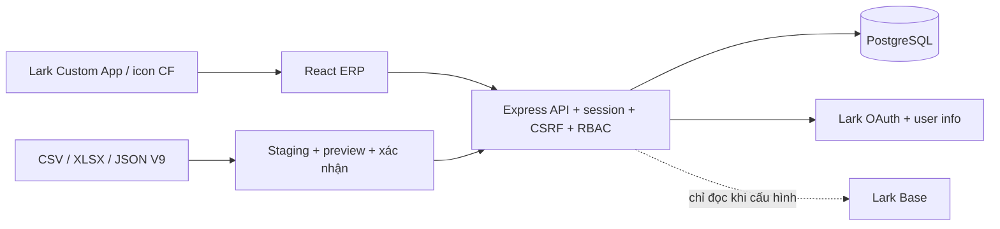

# Kiến trúc và dữ liệu triển khai

Frontend không chứa App Secret, không lấy localStorage làm nguồn nghiệp vụ. Node phục vụ API và bản build frontend cùng origin trong production. PostgreSQL lưu session, người dùng và toàn bộ giao dịch. SDK Lark chỉ được import tại server. Tailwind biên dịch cục bộ; giao diện không phụ thuộc CDN runtime.

## Tổ chức mã

`shared/domain.ts`: schema đầu vào, vòng đời, công thức, tổng giao nhận, quyền. `shared/sales.ts`: chuẩn hóa mã/màu/size, lọc bán, cửa sổ 2/7 ngày và tín hiệu V9. `server/service.ts`: transaction nghiệp vụ. `server/imports.ts`: staging, import và phân tích. `server/auth.ts`: session và Lark. `server/app.ts`: HTTP, export, policy và quản trị. `src/`: màn hình ERP. Migrations là nguồn schema có thể thực thi; không cần đoán từ diagram.

## Bảng dữ liệu

| Bảng | Vai trò |
| --- | --- |
| products, variants | Mã sản phẩm và SKU. SKU duy nhất theo product/color_key/size; body JSONB có input kế hoạch và version |
| suppliers | Danh mục xưởng tạo từ lệnh; đơn vị sản xuất liên kết bằng supplier_id |
| inventory_snapshots | Tồn nullable, inbound, nguồn, thời điểm, actor; receipt không cập nhật bảng này |
| planning_policies | Policy dùng chung, version chống cập nhật đè |
| production_orders, production_order_items | Header, actor, version; dòng tham chiếu SKU, qty và received có CHECK received≤qty |
| order_code_reservations | Mọi mã từng sử dụng, kể cả mã trước khi đổi hoặc lệnh đã xóa |
| production_receipts, production_receipt_items | Đợt nhận bất biến, ngày, ghi chú, actor, khóa gửi lặp/hash/response; snapshot định danh lúc nhận |
| production_order_revisions | Lý do, người sửa, trước/sau và thời điểm |
| archived_orders | Sự kiện xóa/khôi phục và snapshot; không tách mất các dòng/receipts khỏi lệnh |
| activity_logs | Nhật ký append-only; giữ nguyên nguồn V9 và actor nhập riêng |
| import_previews | Payload đã parse, lỗi/trùng/cảnh báo, trạng thái pending/done và người tạo |
| sales_imports, daily_sales | Nguồn file/hash/kỳ/ngày xuất/người nhập/chế độ; dòng đơn đã chuẩn hóa, trạng thái active và nhóm single/combo/unknown/excluded |
| users, session | Danh tính tenant+open_id, một vai trò/người, disabled; session ở PostgreSQL |
| schema_migrations | Migration đã áp dụng, khóa advisory để tránh chạy đồng thời |

JSONB không thay thế ràng buộc giao dịch: khóa ngoại, unique, CHECK và version nằm ở các cột quan trọng. Input JSONB đi qua Zod. Identity SKU đã dùng trong lệnh không được đổi. Số nhận chỉ được thay đổi qua dịch vụ receipt, không nhận trường received từ API sửa lệnh.

## Tính toán và thời gian

Policy mặc định `{targetDays:5,leadDays:3,safeDays:0,includeLead:false,roundTo:1}`. Tốc độ bất thường dùng manualRate; nhánh Tăng trưởng khóa khi tồn null. Mở bán lấy test, không trừ tồn hay làm tròn bội. Hai trạng thái còn lại bằng 0. Tồn mục tiêu ceil(rate×targetDays), raw ceil(rate×effectiveDays−stock−inbound), need làm tròn lên bội. Ngưỡng cảnh báo cover≤leadDays+2 giữ V9. Không đưa nợ xưởng vào công thức thêm lần nữa.

Timestamp giao dịch dùng timestamptz/ISO có offset; hiển thị và tính ngày mã lệnh theo `Asia/Ho_Chi_Minh`. Không suy thời điểm xuất báo cáo từ thời gian tạo đơn muộn nhất. Người nhập khai báo thời điểm xuất/kỳ; tốc độ loại ngày xuất chưa đầy đủ theo ngưỡng 23:55 của V9. TB chia cố định 2/7 như nguồn, có cảnh báo coverage.

## Ghi dữ liệu đồng thời

Mỗi API ghi chạy BEGIN/COMMIT, lỗi rollback. Sửa/nhận/xóa/khôi phục đều khóa header lệnh bằng FOR UPDATE trước khi kiểm tra version và dòng. Một phiên cũ nhận HTTP 409 và phải tải lại. Receipt kiểm tra idempotency dưới cùng khóa; cùng khóa+cùng payload trả lại response cũ, khác payload trả xung đột. Ghi receipt, cộng received, tăng version và audit cùng transaction.

Sửa lệnh không xóa dòng có received>0, không đổi variantId hoặc hạ qty dưới received; lý do ≥3 ký tự. Dòng nhận giữ UUID. Triggers chặn UPDATE/DELETE receipts, receipt items, revisions, archives và audit. Tài khoản database owner vẫn có thể phá schema; deployment phải dùng phân quyền database phù hợp và bảo vệ quyền quản trị ngoài ứng dụng.

Xóa mềm đặt deletedAt và metadata, lưu sự kiện archive. Dashboard bỏ lệnh deleted. Hủy phần chờ đặt cancelled, không xóa lệnh/receipt; pending bằng 0 nhưng placed/received vẫn giữ. Reopen là hành động có lý do/version hoặc lựa chọn rõ khi sửa.

## Phân quyền

Administrator quản trị tất cả. Planner ghi kế hoạch, import, tạo/sửa/hủy/xóa/khôi phục lệnh. Warehouse chỉ đọc và ghi nhận hàng. Manager đọc báo cáo; quyền approve được tách trong mô hình nhưng workflow chưa bật. Viewer chỉ đọc. Mọi API kiểm tra quyền backend, không chỉ ẩn nút. Các nhân viên trong tenant được phép dùng chung dữ liệu; chưa có phân quyền theo từng xưởng/hàng.

Lark tenant và open_id xác định actor. Trường Người đặt là metadata có thể chỉnh sửa, không thay danh tính actor audit. Nguồn V9 giữ nguyên tên người thao tác cũ, gắn nhãn chưa xác thực Lark; actor import được ghi riêng.
